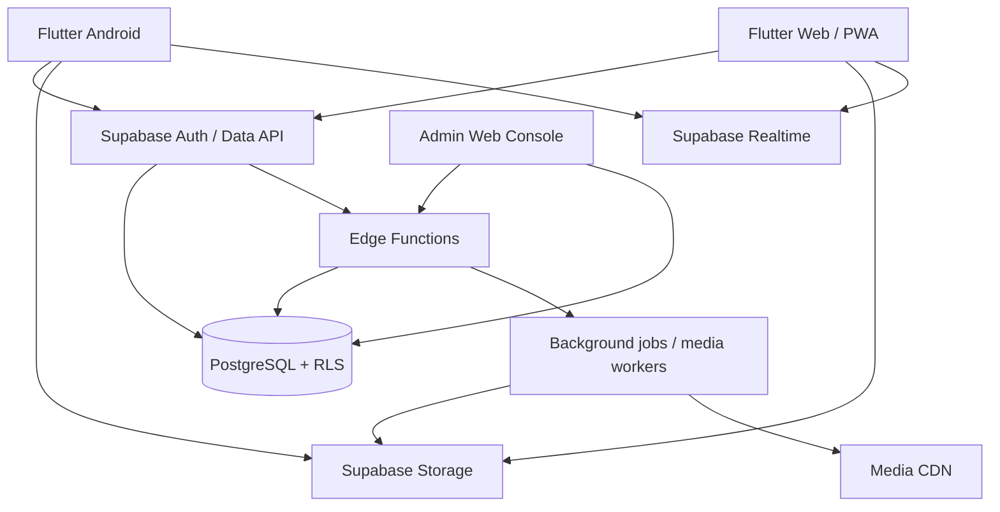

# NEXORA Architecture

## Product
NEXORA is a social platform with an AMOLED-first identity, Arabic-first localization, and consistent Android/web API contracts. Product tagline: **BEYOND SOCIAL.**

## Existing stack (verified)
- Flutter application for Android and Web/PWA output.
- Supabase Auth and PostgreSQL.
- Supabase RLS for client-facing authorization.
- GitHub Actions for analysis, tests, APK, and web builds.
- Current repository is a small Flutter codebase; the UI is still concentrated in `lib/main.dart`.

## Target architecture

## Module boundaries to maintain
- `core`: app bootstrap, routing, theme, localization, error handling, secure config.
- `features/auth`: registration, sign-in, recovery, session/device management.
- `features/profile`: public profile and private account settings.
- `features/social`: follows, friend requests, blocks, feed, posts, comments, reactions.
- `features/media`: upload, processing state, stories, reels, long-form video.
- `features/messaging`: conversations, members, messages, attachments, reactions, call signaling.
- `features/communities`: communities, groups, channels, events.
- `features/safety`: reports, moderation, appeals, privacy center.
- `features/notifications`: in-app and push notifications.
- `features/admin`: role-gated moderation and operational dashboard.

## Non-negotiable architecture rules
1. The client never decides authorization; PostgreSQL RLS and trusted server functions do.
2. Never put service-role/secret keys in Flutter, web bundles, or GitHub build arguments.
3. Do not label messages E2EE until an audited protocol, key lifecycle, and client encryption are implemented.
4. Do not expose exact user locations; Nearby must be opt-in and approximate.
5. Use migrations for every schema change and verify RLS/grants after applying them.
6. Every feature has an explicit status: implemented, partial, or pending.
7. Media processing, push delivery, WebRTC TURN, and admin privilege assignment require trusted infrastructure and credentials; the UI must not fake them.

## Current implementation boundary
The Flutter app currently has email/password auth, basic profiles, text posts, basic follows, and a simple feed. The database foundation was extended with friendship, messaging, notification, story, community, reporting, call-signaling, and private preference tables. Those tables are not equivalent to completed client features or production integrations.
