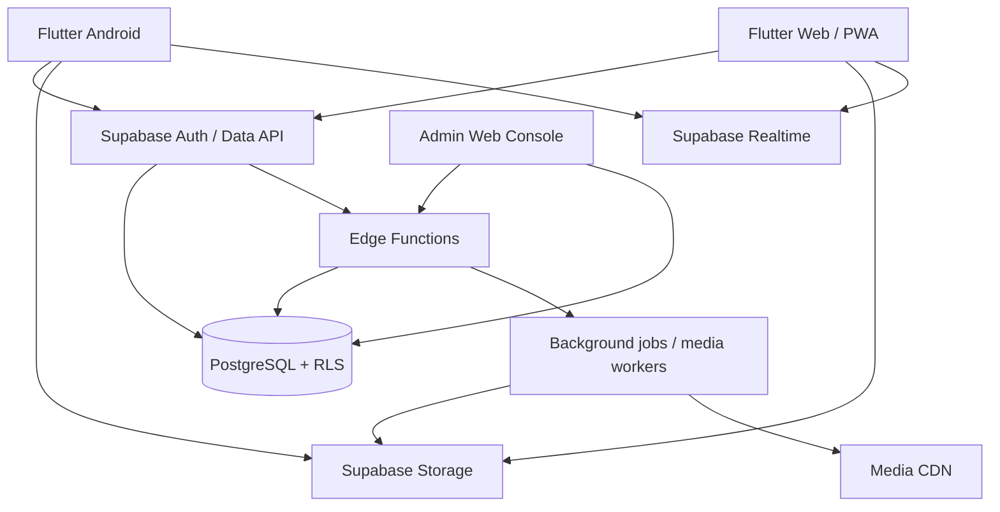

# NEXORA Architecture

## Product
NEXORA is a social platform with an AMOLED-first identity, Arabic-first localization, and consistent cross-platform API contracts as a target. Product tagline: **BEYOND SOCIAL.**

## Existing stack (verified)
- Flutter application source. Android platform scaffolding is generated by the manually gated preview workflow; a committed Web/PWA platform scaffold is not currently present.
- Supabase Auth and PostgreSQL.
- Supabase RLS for client-facing authorization.
- GitHub Actions for source analysis/tests and a manually gated Android debug-preview APK. No AAB or Flutter Web release workflow was found in the inspected workflow directory.
- Current repository is a small Flutter codebase; the UI is still concentrated in `lib/main.dart`.

## Target architecture

## Module boundaries to maintain
- `core`: app bootstrap, routing, theme, localization, error handling, secure config.
- `features/auth`: registration, sign-in, recovery, session/device management.
- `features/profile`: public profile and private account settings.
- `features/social`: follows, friend requests, blocks, feed, posts, comments, reactions.
- `features/media`: upload, processing state, stories, reels, long-form video.
- `features/messaging`: conversations, members, messages, attachments, reactions, call signaling.
- `features/communities`: communities, groups, channels, events.
- `features/safety`: reports, moderation, appeals, privacy center.
- `features/notifications`: in-app and push notifications.
- `features/admin`: role-gated moderation and operational dashboard.

## Non-negotiable architecture rules
1. The client never decides authorization; PostgreSQL RLS and trusted server functions do.
2. Never put service-role/secret keys in Flutter, web bundles, or GitHub build arguments.
3. Do not label messages E2EE until an audited protocol, key lifecycle, and client encryption are implemented.
4. Do not expose exact user locations; Nearby must be opt-in and approximate.
5. Use migrations for every schema change and verify RLS/grants after applying them.
6. Every feature has an explicit status: implemented, partial, or pending.
7. Media processing, push delivery, WebRTC TURN, and admin privilege assignment require trusted infrastructure and credentials; the UI must not fake them.

## Current implementation boundary

The repository is beyond a text-post-only prototype, but it is not production complete. The dated [IMPLEMENTATION_STATUS.md](IMPLEMENTATION_STATUS.md) is the feature-level source of truth and documents partial workflows for profiles/private media, posts/feed/comments, follows/friendships, messaging, stories, communities, notifications, safety/moderation, nearby discovery and themes. Read each feature's status notes before relying on it. CI/build inventory was rechecked on 2026-11-06: `flutter-ci.yml` performs source analysis/tests, while `android-preview.yml` is a manually gated debug-APK workflow; no AAB/Web release workflow was present.

Important distinctions:
- Phone-first OTP UI exists, but SMS provider delivery, cost and real-device verification are not production-verified; email/password is an alternative.
- Text-only post creation and public-feed querying are documented as implemented; the wider post/media experience remains Partial.
- Messaging is not E2EE; message bodies remain server-readable.
- Call-session records are signaling foundations, not voice/video calls. WebRTC, STUN/TURN and reliable incoming-call delivery remain pending.
- FCM code and a deployed Edge Function/webhook are documented, but real-device delivery depends on secrets and a registered device.
- Private Storage and client upload UI do not imply server-side malware scanning, transcoding, thumbnails, resumable uploads or CDN delivery.
- Database foundations do not imply complete production workflows or a finished admin console.

The module boundaries above are target architecture. The current codebase may not yet be split into those modules; do not claim a module exists merely because it is listed.

Source CI success does not establish real-device, provider, RLS integration, store-signing or production readiness. APK/AAB/Web packaging remains paused until source/code/file completion, review and explicit build approval.
