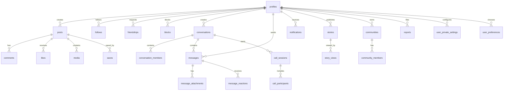

# NEXORA Database ERD

The diagram shows the current core and newly added foundation tables. It is not a claim that every related client workflow is complete.

## Table groups

- Identity and preferences: `profiles`, `user_private_settings`, `user_preferences`.
- Social graph: `follows`, `friendships`, `blocks`.
- Publishing and discovery: `posts`, `media`, `likes`, `reposts`, `saves`, `comments`, `comment_likes`, `hashtags`, `post_hashtags`, `collections`, `collection_items`, `stories`, `story_views`.
- Messaging: `conversations`, `conversation_members`, `messages`, `message_attachments`, `message_reactions`.
- Communities: `communities`, `community_members`, `community_channels`, `community_invites`.
- Safety and moderation: `reports`, `moderation_actions`, `moderation_appeals`, `staff_members`, `audit_logs`.
- Realtime call foundation: `call_sessions`, `call_participants`.
- Notifications and devices: `notifications`, `notification_preferences`, `user_devices`.
- Private discovery storage: `private.profile_discovery_locations`.

## Security model
All newly added public tables have RLS enabled. Anonymous SELECT is revoked. User-scoped data is filtered by auth.uid() or a narrowly scoped membership helper. Column-level update grants are used on sensitive membership, conversation, message, notification, and call fields.

## Completeness and provenance warning

This ERD is a **partial conceptual diagram**, not a generated inventory of the deployed database. It does not prove that every table, column, foreign key, index, policy, grant, or migration mapping is represented. Do not use it alone to write migrations or infer exact client payloads.

The live inventory and table groups below now name these supporting areas, but the Mermaid relationship diagram remains conceptual and does not draw every FK or operational relationship. In particular, the diagram does not yet show all relationships for reposts, hashtags, collections, user-device registration, moderation actions/appeals, nearby-location storage, notification preferences, community invites, or audit records.

This is an ERD completeness limitation, not evidence that those live objects are absent.

## Live table inventory snapshot — 2026-11-06

Read-only catalog queries returned **38 ordinary tables in `public` and one ordinary table in `private`**; a separate `pg_class` check returned no views or materialized views in those schemas. All 39 ordinary tables were previously verified to have RLS enabled.

### Public tables (38)

- `audit_logs`
- `blocks`
- `call_participants`
- `call_sessions`
- `collection_items`
- `collections`
- `comment_likes`
- `comments`
- `communities`
- `community_channels`
- `community_invites`
- `community_members`
- `conversation_members`
- `conversations`
- `follows`
- `friendships`
- `hashtags`
- `likes`
- `media`
- `message_attachments`
- `message_reactions`
- `messages`
- `moderation_actions`
- `moderation_appeals`
- `notification_preferences`
- `notifications`
- `post_hashtags`
- `posts`
- `profiles`
- `reports`
- `reposts`
- `saves`
- `staff_members`
- `stories`
- `story_views`
- `user_devices`
- `user_preferences`
- `user_private_settings`

### Private tables (1)

- `profile_discovery_locations`

## Verified foreign-key relationships — 2026-11-06

The following **67 foreign-key constraints** were read directly from `pg_constraint`. Each PostgreSQL-rendered definition preserves the exact source and referenced columns, including composite keys and references into `auth.users`.

| Source table | Constraint | PostgreSQL definition |
|---|---|---|
| `private.profile_discovery_locations` | `profile_discovery_locations_user_id_fkey` | `FOREIGN KEY (user_id) REFERENCES profiles(id) ON DELETE CASCADE` |
| `public.blocks` | `blocks_blocked_id_fkey` | `FOREIGN KEY (blocked_id) REFERENCES profiles(id) ON DELETE CASCADE` |
| `public.blocks` | `blocks_blocker_id_fkey` | `FOREIGN KEY (blocker_id) REFERENCES profiles(id) ON DELETE CASCADE` |
| `public.call_participants` | `call_participants_call_id_fkey` | `FOREIGN KEY (call_id) REFERENCES call_sessions(id) ON DELETE CASCADE` |
| `public.call_participants` | `call_participants_user_id_fkey` | `FOREIGN KEY (user_id) REFERENCES profiles(id) ON DELETE CASCADE` |
| `public.call_sessions` | `call_sessions_conversation_id_fkey` | `FOREIGN KEY (conversation_id) REFERENCES conversations(id) ON DELETE CASCADE` |
| `public.call_sessions` | `call_sessions_initiated_by_fkey` | `FOREIGN KEY (initiated_by) REFERENCES profiles(id) ON DELETE RESTRICT` |
| `public.collection_items` | `collection_items_collection_id_fkey` | `FOREIGN KEY (collection_id) REFERENCES collections(id) ON DELETE CASCADE` |
| `public.collection_items` | `collection_items_post_id_fkey` | `FOREIGN KEY (post_id) REFERENCES posts(id) ON DELETE CASCADE` |
| `public.collections` | `collections_user_id_fkey` | `FOREIGN KEY (user_id) REFERENCES profiles(id) ON DELETE CASCADE` |
| `public.comment_likes` | `comment_likes_comment_id_fkey` | `FOREIGN KEY (comment_id) REFERENCES comments(id) ON DELETE CASCADE` |
| `public.comment_likes` | `comment_likes_user_id_fkey` | `FOREIGN KEY (user_id) REFERENCES profiles(id) ON DELETE CASCADE` |
| `public.comments` | `comments_parent_id_fkey` | `FOREIGN KEY (parent_id) REFERENCES comments(id) ON DELETE CASCADE` |
| `public.comments` | `comments_post_id_fkey` | `FOREIGN KEY (post_id) REFERENCES posts(id) ON DELETE CASCADE` |
| `public.comments` | `comments_user_id_fkey` | `FOREIGN KEY (user_id) REFERENCES profiles(id) ON DELETE CASCADE` |
| `public.communities` | `communities_owner_id_fkey` | `FOREIGN KEY (owner_id) REFERENCES profiles(id) ON DELETE RESTRICT` |
| `public.community_channels` | `community_channels_community_id_fkey` | `FOREIGN KEY (community_id) REFERENCES communities(id) ON DELETE CASCADE` |
| `public.community_channels` | `community_channels_conversation_id_fkey` | `FOREIGN KEY (conversation_id) REFERENCES conversations(id) ON DELETE CASCADE` |
| `public.community_channels` | `community_channels_created_by_fkey` | `FOREIGN KEY (created_by) REFERENCES auth.users(id) ON DELETE RESTRICT` |
| `public.community_invites` | `community_invites_community_id_fkey` | `FOREIGN KEY (community_id) REFERENCES communities(id) ON DELETE CASCADE` |
| `public.community_invites` | `community_invites_created_by_fkey` | `FOREIGN KEY (created_by) REFERENCES profiles(id) ON DELETE RESTRICT` |
| `public.community_members` | `community_members_community_id_fkey` | `FOREIGN KEY (community_id) REFERENCES communities(id) ON DELETE CASCADE` |
| `public.community_members` | `community_members_user_id_fkey` | `FOREIGN KEY (user_id) REFERENCES profiles(id) ON DELETE CASCADE` |
| `public.conversation_members` | `conversation_members_conversation_id_fkey` | `FOREIGN KEY (conversation_id) REFERENCES conversations(id) ON DELETE CASCADE` |
| `public.conversation_members` | `conversation_members_user_id_fkey` | `FOREIGN KEY (user_id) REFERENCES profiles(id) ON DELETE CASCADE` |
| `public.conversations` | `conversations_created_by_fkey` | `FOREIGN KEY (created_by) REFERENCES profiles(id) ON DELETE RESTRICT` |
| `public.follows` | `follows_follower_id_fkey` | `FOREIGN KEY (follower_id) REFERENCES profiles(id) ON DELETE CASCADE` |
| `public.follows` | `follows_following_id_fkey` | `FOREIGN KEY (following_id) REFERENCES profiles(id) ON DELETE CASCADE` |
| `public.friendships` | `friendships_addressee_id_fkey` | `FOREIGN KEY (addressee_id) REFERENCES profiles(id) ON DELETE CASCADE` |
| `public.friendships` | `friendships_requester_id_fkey` | `FOREIGN KEY (requester_id) REFERENCES profiles(id) ON DELETE CASCADE` |
| `public.likes` | `likes_post_id_fkey` | `FOREIGN KEY (post_id) REFERENCES posts(id) ON DELETE CASCADE` |
| `public.likes` | `likes_user_id_fkey` | `FOREIGN KEY (user_id) REFERENCES profiles(id) ON DELETE CASCADE` |
| `public.media` | `media_post_id_fkey` | `FOREIGN KEY (post_id) REFERENCES posts(id) ON DELETE CASCADE` |
| `public.media` | `media_user_id_fkey` | `FOREIGN KEY (user_id) REFERENCES profiles(id) ON DELETE CASCADE` |
| `public.message_attachments` | `message_attachments_message_id_fkey` | `FOREIGN KEY (message_id) REFERENCES messages(id) ON DELETE CASCADE` |
| `public.message_attachments` | `message_attachments_uploader_id_fkey` | `FOREIGN KEY (uploader_id) REFERENCES profiles(id) ON DELETE CASCADE` |
| `public.message_reactions` | `message_reactions_message_id_fkey` | `FOREIGN KEY (message_id) REFERENCES messages(id) ON DELETE CASCADE` |
| `public.message_reactions` | `message_reactions_user_id_fkey` | `FOREIGN KEY (user_id) REFERENCES profiles(id) ON DELETE CASCADE` |
| `public.messages` | `messages_conversation_id_fkey` | `FOREIGN KEY (conversation_id) REFERENCES conversations(id) ON DELETE CASCADE` |
| `public.messages` | `messages_reply_to_fkey` | `FOREIGN KEY (reply_to) REFERENCES messages(id) ON DELETE SET NULL` |
| `public.messages` | `messages_sender_id_fkey` | `FOREIGN KEY (sender_id) REFERENCES profiles(id) ON DELETE RESTRICT` |
| `public.moderation_actions` | `moderation_actions_moderator_id_fkey` | `FOREIGN KEY (moderator_id) REFERENCES auth.users(id)` |
| `public.moderation_actions` | `moderation_actions_report_id_fkey` | `FOREIGN KEY (report_id) REFERENCES reports(id) ON DELETE SET NULL` |
| `public.moderation_appeals` | `moderation_appeals_action_id_fkey` | `FOREIGN KEY (action_id) REFERENCES moderation_actions(id) ON DELETE CASCADE` |
| `public.moderation_appeals` | `moderation_appeals_reviewer_id_fkey` | `FOREIGN KEY (reviewer_id) REFERENCES auth.users(id) ON DELETE SET NULL` |
| `public.moderation_appeals` | `moderation_appeals_user_id_fkey` | `FOREIGN KEY (user_id) REFERENCES auth.users(id) ON DELETE CASCADE` |
| `public.notification_preferences` | `notification_preferences_user_id_fkey` | `FOREIGN KEY (user_id) REFERENCES auth.users(id) ON DELETE CASCADE` |
| `public.notifications` | `notifications_actor_id_fkey` | `FOREIGN KEY (actor_id) REFERENCES profiles(id) ON DELETE SET NULL` |
| `public.notifications` | `notifications_recipient_id_fkey` | `FOREIGN KEY (recipient_id) REFERENCES profiles(id) ON DELETE CASCADE` |
| `public.post_hashtags` | `post_hashtags_hashtag_id_fkey` | `FOREIGN KEY (hashtag_id) REFERENCES hashtags(id) ON DELETE CASCADE` |
| `public.post_hashtags` | `post_hashtags_post_id_fkey` | `FOREIGN KEY (post_id) REFERENCES posts(id) ON DELETE CASCADE` |
| `public.posts` | `posts_user_id_fkey` | `FOREIGN KEY (user_id) REFERENCES profiles(id) ON DELETE CASCADE` |
| `public.profiles` | `profiles_id_fkey` | `FOREIGN KEY (id) REFERENCES auth.users(id) ON DELETE CASCADE` |
| `public.reports` | `reports_assigned_to_fkey` | `FOREIGN KEY (assigned_to) REFERENCES auth.users(id) ON DELETE SET NULL` |
| `public.reports` | `reports_reporter_id_fkey` | `FOREIGN KEY (reporter_id) REFERENCES profiles(id) ON DELETE CASCADE` |
| `public.reposts` | `reposts_post_id_fkey` | `FOREIGN KEY (post_id) REFERENCES posts(id) ON DELETE CASCADE` |
| `public.reposts` | `reposts_user_id_fkey` | `FOREIGN KEY (user_id) REFERENCES profiles(id) ON DELETE CASCADE` |
| `public.saves` | `saves_post_id_fkey` | `FOREIGN KEY (post_id) REFERENCES posts(id) ON DELETE CASCADE` |
| `public.saves` | `saves_user_id_fkey` | `FOREIGN KEY (user_id) REFERENCES profiles(id) ON DELETE CASCADE` |
| `public.staff_members` | `staff_members_created_by_fkey` | `FOREIGN KEY (created_by) REFERENCES auth.users(id) ON DELETE SET NULL` |
| `public.staff_members` | `staff_members_user_id_fkey` | `FOREIGN KEY (user_id) REFERENCES auth.users(id) ON DELETE CASCADE` |
| `public.stories` | `stories_user_id_fkey` | `FOREIGN KEY (user_id) REFERENCES profiles(id) ON DELETE CASCADE` |
| `public.story_views` | `story_views_story_id_fkey` | `FOREIGN KEY (story_id) REFERENCES stories(id) ON DELETE CASCADE` |
| `public.story_views` | `story_views_viewer_id_fkey` | `FOREIGN KEY (viewer_id) REFERENCES profiles(id) ON DELETE CASCADE` |
| `public.user_devices` | `user_devices_user_id_fkey` | `FOREIGN KEY (user_id) REFERENCES auth.users(id) ON DELETE CASCADE` |
| `public.user_preferences` | `user_preferences_user_id_fkey` | `FOREIGN KEY (user_id) REFERENCES profiles(id) ON DELETE CASCADE` |
| `public.user_private_settings` | `user_private_settings_user_id_fkey` | `FOREIGN KEY (user_id) REFERENCES profiles(id) ON DELETE CASCADE` |

### Remaining ERD evidence gaps

This inventory records object names and types only. It does not replace the detailed per-object inventory of:

| Field | Required evidence |
|---|---|
| Columns and constraints | Live catalog definition, including nullability and defaults |
| Foreign keys and indexes | Live catalog definitions |
| RLS enabled/forced | Live table flags |
| Policies | Exact policy expressions and command scope |
| Grants | Role and operation/column-level privileges |
| Migration provenance | Exact remote migration version mapped to local SQL source |
| Client usage | Dart source file and call-site reference |
| Feature owner/status | Matching entry in IMPLEMENTATION_STATUS.md |
| Test evidence | Reproducible test identifier and result |

### Catalog-level structural and RLS snapshot

The same read-only catalog pass recorded:

| Metric | Live result |
|---|---:|
| Public columns | 250 |
| Private columns | 4 |
| Total columns | 254 |
| NOT NULL columns | 193 |
| Columns with defaults | 114 |
| Primary-key constraints | 39 |
| Foreign-key constraints | 67 |
| Unique constraints | 9 |
| Check constraints | 51 |
| Indexes | 106 |
| RLS-enabled ordinary tables | 39 / 39 |
| RLS-forced ordinary tables | 0 / 39 |
| Public policies | 111 |
| Private policies | 1 |

All 38 public tables and the one private table have RLS enabled. None has FORCE ROW LEVEL SECURITY. This is an important distinction: table owners and roles with BYPASSRLS can bypass ordinary RLS, so policy presence alone does not establish end-to-end access safety. The policy counts above are catalog counts, not a correctness verdict; every policy expression, grant, SECURITY DEFINER path, and actual authenticated/anonymous behavior still requires review.

The 67 foreign keys and 106 indexes are structural counts only. Their names, referenced columns, delete/update actions, partial predicates, and query-plan suitability are not exhaustively documented in this ERD snapshot. No index was added or removed.

### Migration safety

The implementation audit records a mismatch between remote migration history and local migration files. Until every remote version is mapped to exact source SQL and a recoverable backup is verified, do not run `supabase db push`, reset, replay, or any schema-changing operation. This ERD update does not authorize database changes.

### Detailed machine-readable catalog snapshots

For exact deployed definitions captured read-only on 2026-11-06, see:

- `docs/ERD-LIVE-COLUMNS.md` — all 254 deployed columns with PostgreSQL type, nullability, and default.
- `docs/ERD-LIVE-CONSTRAINTS.md` — all 166 primary-key, foreign-key, unique, and check constraints with PostgreSQL-rendered definitions.
- `docs/ERD-LIVE-INDEXES.md` — all 106 deployed index definitions.

These snapshots are descriptive only. They do not replace local migration source or authorize schema changes.

- `docs/ERD-LIVE-POLICIES.md` — all 112 deployed RLS policy definitions, including command, roles, USING, and WITH CHECK expressions.

- `docs/ERD-LIVE-TRIGGERS.md` — 21 non-internal trigger definitions across auth, public, and storage schemas, including the application trigger functions.
