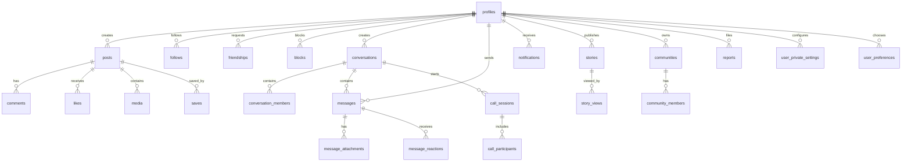

# NEXORA Database ERD

The diagram shows the current core and newly added foundation tables. It is not a claim that every related client workflow is complete.

## Table groups
- Identity: profiles, user_private_settings, user_preferences.
- Social graph: follows, friendships, blocks.
- Publishing: posts, media, likes, comments, saves, stories, story_views.
- Messaging: conversations, conversation_members, messages, message_attachments, message_reactions.
- Communities: communities, community_members.
- Safety: reports.
- Realtime call foundation: call_sessions, call_participants.
- Notifications: notifications.

## Security model
All newly added public tables have RLS enabled. Anonymous SELECT is revoked. User-scoped data is filtered by auth.uid() or a narrowly scoped membership helper. Column-level update grants are used on sensitive membership, conversation, message, notification, and call fields.
