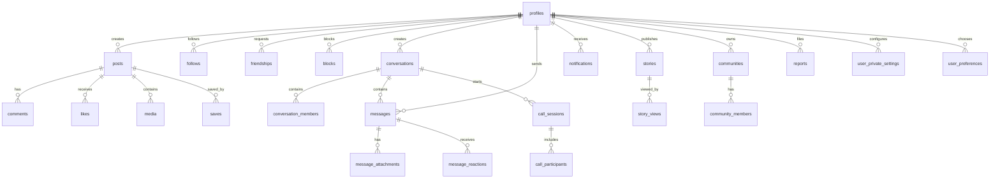

# NEXORA Database ERD

The diagram shows the current core and newly added foundation tables. It is not a claim that every related client workflow is complete.

## Table groups
- Identity: profiles, user_private_settings, user_preferences.
- Social graph: follows, friendships, blocks.
- Publishing: posts, media, likes, comments, saves, stories, story_views.
- Messaging: conversations, conversation_members, messages, message_attachments, message_reactions.
- Communities: communities, community_members.
- Safety: reports.
- Realtime call foundation: call_sessions, call_participants.
- Notifications: notifications.

## Security model
All newly added public tables have RLS enabled. Anonymous SELECT is revoked. User-scoped data is filtered by auth.uid() or a narrowly scoped membership helper. Column-level update grants are used on sensitive membership, conversation, message, notification, and call fields.

## Completeness and provenance warning

This ERD is a **partial conceptual diagram**, not a generated inventory of the deployed database. It does not prove that every table, column, foreign key, index, policy, grant, or migration mapping is represented. Do not use it alone to write migrations or infer exact client payloads.

The documentation audit has already identified omitted or incompletely represented areas, including:
- `reposts`, `hashtags`, and `post_hashtags`;
- user-device registration and push-token records;
- moderation actions and appeals;
- private/approximate nearby-location storage;
- supporting notification, invitation, and operational objects.

This list is an audit reminder, not a claim that every object has been freshly re-queried or that these names exhaust the live schema.

## Live table inventory snapshot — 2026-11-06

A read-only query of `information_schema.tables` returned **38 ordinary tables in `public` and one ordinary table in `private`**. The same query returned no views or materialized views in those two schemas.

### Public tables (38)

- `audit_logs`
- `blocks`
- `call_participants`
- `call_sessions`
- `collection_items`
- `collections`
- `comment_likes`
- `comments`
- `communities`
- `community_channels`
- `community_invites`
- `community_members`
- `conversation_members`
- `conversations`
- `follows`
- `friendships`
- `hashtags`
- `likes`
- `media`
- `message_attachments`
- `message_reactions`
- `messages`
- `moderation_actions`
- `moderation_appeals`
- `notification_preferences`
- `notifications`
- `post_hashtags`
- `posts`
- `profiles`
- `reports`
- `reposts`
- `saves`
- `staff_members`
- `stories`
- `story_views`
- `user_devices`
- `user_preferences`
- `user_private_settings`

### Private tables (1)

- `profile_discovery_locations`

### Remaining ERD evidence gaps

This inventory records object names and types only. It does not replace the detailed per-object inventory of:

| Field | Required evidence |
|---|---|
| Columns and constraints | Live catalog definition, including nullability and defaults |
| Foreign keys and indexes | Live catalog definitions |
| RLS enabled/forced | Live table flags |
| Policies | Exact policy expressions and command scope |
| Grants | Role and operation/column-level privileges |
| Migration provenance | Exact remote migration version mapped to local SQL source |
| Client usage | Dart source file and call-site reference |
| Feature owner/status | Matching entry in IMPLEMENTATION_STATUS.md |
| Test evidence | Reproducible test identifier and result |

### Migration safety

The implementation audit records a mismatch between remote migration history and local migration files. Until every remote version is mapped to exact source SQL and a recoverable backup is verified, do not run `supabase db push`, reset, replay, or any schema-changing operation. This ERD update does not authorize database changes.
